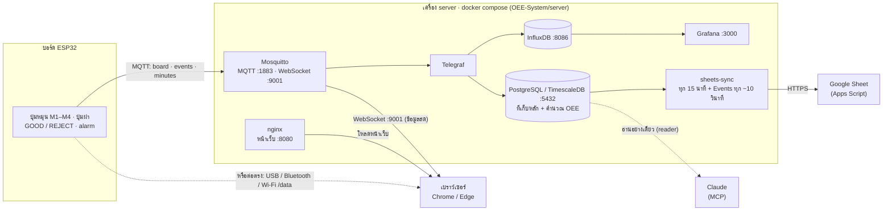

# Smart Factory OEE — Group 3

ระบบวัด OEE ของไลน์ผลิตจำลอง 4 เครื่อง: บอร์ด ESP32 ส่งสัญญาณผ่าน MQTT → เครื่อง server เก็บลง database, แสดงบนหน้าเว็บ / Grafana และส่งสรุปขึ้น Google Sheet



- **ESP32** อ่านปุ่ม / สวิตช์ แล้วส่ง 3 topic ผ่าน MQTT: `board` (สถานะสด ~1 ครั้ง/วินาที), `events` (กดปุ่ม, เปิดฝา, เดิน / หยุด, ผลิตเสร็จ 1 ชิ้น), `minutes` (สรุปทุก 1 นาที / เครื่อง)
- **Mosquitto** เป็นตัวกลาง: ส่งต่อให้ Telegraf และให้หน้าเว็บผ่าน WebSocket
- **Telegraf** เขียนทุกข้อความลง **PostgreSQL** (ที่เก็บหลัก, คำนวณ OEE ด้วย view `oee_daily` / `oee_hourly`) และ **InfluxDB** (ให้ Grafana วาดกราฟสด)
- **sheets-sync** อ่านสรุป OEE จาก PostgreSQL ส่งขึ้น **Google Sheet**
- **Claude** อ่าน database ผ่าน MCP ด้วย user `reader` (อ่านอย่างเดียว)
- หน้าเว็บต่อบอร์ดตรงๆ ได้ด้วย (USB / Bluetooth / Wi-Fi) โดยไม่ต้องมี server — แต่จะไม่มีการบันทึกลง database

คู่มือนี้คือ **ขั้นตอนทั้งหมดหลัง clone ไปใช้บนเครื่องใหม่** — รายละเอียดเชิงลึก (ตาราง database, สูตร OEE, topic MQTT, โครงหน้าเว็บ) อยู่ใน [`OEE-System/README.md`](OEE-System/README.md)

## มีอะไรใน repo

```
├── README.md                 ← ไฟล์นี้
├── OEE-System/               ← ตัวระบบทั้งหมด
│   ├── server/               ← docker compose: Mosquitto, PostgreSQL/TimescaleDB, InfluxDB, Telegraf, Grafana, เว็บ, sheets-sync
│   ├── website/              ← หน้าเว็บ dashboard
│   ├── esp32/                ← โค้ดบอร์ด (Arduino)
│   └── google-sheets/        ← โค้ด Apps Script สำหรับ Google Sheet
└── docs/
    ├── wiring-map.html       ← แผนผังต่อสายบอร์ด ESP32 (เปิดด้วยเบราว์เซอร์)
    └── machines/             ← ภาพเครื่องจักรต้นแบบ (Okuma LNC-8, Okuma GENOS L250E, GFIR CK0620/II)
```

> ⚠️ **รหัสผ่านไม่ได้อยู่ใน repo** — หลัง clone ต้องสร้างไฟล์รหัสเอง 2 ไฟล์ (ขั้นตอนที่ 3 และ 6): `OEE-System/server/.env` และ `OEE-System/esp32/SmartFactoryBoard_MQTT/secrets.h` ทั้งสองไฟล์อยู่ใน `.gitignore` แล้ว **ห้าม commit ขึ้น GitHub**

---

## 1. ติดตั้งเครื่องมือ

| เครื่องมือ | จำเป็นไหม | ใช้ทำอะไร | ดาวน์โหลด |
|---|---|---|---|
| **Git** | ✅ จำเป็น | clone repo | https://git-scm.com/downloads |
| **Docker** | ✅ จำเป็น | รันทุกอย่างฝั่ง server | Windows / Mac: **Docker Desktop** — https://www.docker.com/products/docker-desktop/ · Linux: Docker Engine + compose plugin — https://docs.docker.com/engine/install/ |
| **Chrome หรือ Edge** | ✅ จำเป็น | เปิดหน้าเว็บ (Bluetooth / USB ใช้ได้เฉพาะ Chrome / Edge) | — |
| **Arduino IDE 2** | ถ้าต้องอัปโหลดโค้ดลงบอร์ด | อัปโหลดโค้ดลง ESP32 | https://www.arduino.cc/en/software |
| ↳ บอร์ด **esp32 by Espressif** (v3.x) | ″ | Boards Manager ใน Arduino IDE | ค้นคำว่า `esp32` |
| ↳ ไลบรารี **PubSubClient** (by Nick O'Leary) | ″ | Library Manager ใน Arduino IDE | ค้นคำว่า `PubSubClient` |
| ↳ ไดรเวอร์ USB ของบอร์ด (CP210x หรือ CH340) | ถ้าเครื่องมองไม่เห็นพอร์ต | ต่อบอร์ดผ่าน USB | ดูชิปบนบอร์ด |
| **Claude Code** หรือ **Claude Desktop** | ไม่บังคับ | ให้ Claude อ่าน database ผ่าน MCP | https://claude.com/download |

ไม่ต้องติดตั้ง Python, Node.js, PostgreSQL หรือ Grafana เอง — Docker โหลดให้ทั้งหมด

**Windows:** ตอนติดตั้ง Docker Desktop ให้เลือกใช้ **WSL 2** แล้วรีสตาร์ทเครื่อง · **Raspberry Pi:** ใช้ Pi 4 / 5 และ OS แบบ 64-bit

---

## 2. Clone repo

```bash
git clone https://github.com/tazriqq/Smart-Factory-G3.git
cd Smart-Factory-G3/OEE-System/server
```

---

## 3. สร้างไฟล์รหัสผ่าน `server/.env`

```bash
cp .env.example .env          # Windows PowerShell: copy .env.example .env
```

เปิด `.env` ด้วย Notepad / TextEdit / VS Code แล้ว **เปลี่ยนทุกค่าที่ขึ้นต้นด้วย `change-me`**:

| ค่า | ใส่อะไร |
|---|---|
| `INFLUX_ADMIN_PASSWORD` | รหัสอย่างน้อย 8 ตัว |
| `INFLUX_TOKEN` | ข้อความสุ่มยาวๆ |
| `MQTT_ESP32_PASS` | รหัสของบอร์ด (ใช้อีกทีในขั้นตอนที่ 6) |
| `MQTT_WEB_PASS` **และ** `MQTT_PASS` | รหัสของหน้าเว็บ — **สองช่องนี้ต้องเหมือนกัน** |
| `GRAFANA_ADMIN_PASSWORD` | รหัสเข้า Grafana |
| `PG_ADMIN_PASSWORD`, `PG_TELEGRAF_PASS`, `PG_READER_PASS` | รหัส database 3 ตัว |
| `SHEETS_URL`, `SHEETS_KEY` | ถ้ายังไม่ใช้ Google Sheet ให้ **เว้น `SHEETS_URL=` ว่างไว้** (ตั้งทีหลังในขั้นตอนที่ 7) |

สุ่มรหัสง่ายๆ (Mac / Linux / Git Bash): `openssl rand -hex 16`

> รหัส InfluxDB / PostgreSQL ถูกใช้ **ตอนเปิดครั้งแรกเท่านั้น** — ถ้าเปิดไปแล้วค่อยแก้ ต้องล้างข้อมูลด้วย `docker compose down -v` แล้วเปิดใหม่

---

## 4. เปิดระบบ

1. **เปิด Docker Desktop** ให้ขึ้นว่า running (Linux ข้ามขั้นนี้)
2. ในโฟลเดอร์ `OEE-System/server` สั่ง (**ครั้งแรกต้องมีอินเทอร์เน็ต** — โหลด image ราว 1–2 GB)
   ```bash
   docker compose up -d
   ```
3. ตรวจว่าขึ้นครบ 7 ตัว (mosquitto, web, timescaledb, influxdb, telegraf, grafana, sheets-sync) และ `timescaledb`, `influxdb` เป็น `healthy`
   ```bash
   docker compose ps
   ```
   ถ้ามีตัวไหนไม่ขึ้น ดูสาเหตุด้วย `docker compose logs <ชื่อ>` เช่น `docker compose logs telegraf`

ครั้งแรก database จะถูกสร้าง **ว่างเปล่า** พร้อมตารางทั้งหมด

---

## 5. หา IP ของเครื่อง server

| ระบบ | คำสั่ง | ดูที่ |
|---|---|---|
| Windows | `ipconfig` | IPv4 Address ของ Wi-Fi |
| Mac | `ipconfig getifaddr en0` | — |
| Linux | `hostname -I` | ตัวแรก |

ต่อจากนี้เรียก IP นี้ว่า **`<SERVER_IP>`**

- **ล็อก IP:** เข้าหน้าเราเตอร์ (ปกติ `http://192.168.1.1`) → DHCP → **Address Reservation / Static Lease** → จอง `<SERVER_IP>` ให้เครื่องนี้ ไม่อย่างนั้นวันหนึ่ง IP เปลี่ยน บอร์ดจะหา server ไม่เจอ
- **Firewall:** ถ้า Windows ถามตอนเปิด Docker ให้กด **Allow** (Private network) · พอร์ตที่ใช้: `1883` (บอร์ด), `9001` (หน้าเว็บ MQTT), `8080` (หน้าเว็บ), `3000` (Grafana), `5432` (database), `8086` (InfluxDB)

---

## 6. ตั้งค่าบอร์ด ESP32

1. ในโฟลเดอร์ `OEE-System/esp32/SmartFactoryBoard_MQTT/` copy `secrets.example.h` เป็น **`secrets.h`** แล้วแก้
   ```cpp
   #define SECRET_WIFI_SSID      "ชื่อ Wi-Fi"            // ต้องเป็น 2.4 GHz และวงเดียวกับ server
   #define SECRET_WIFI_PASS      "รหัส Wi-Fi"
   #define SECRET_MQTT_HOST      "<SERVER_IP>"
   #define SECRET_MQTT_PASS      "<MQTT_ESP32_PASS จาก server/.env>"
   ```
2. **ถ้าวง Wi-Fi ไม่ใช่ `192.168.1.x`** แก้ใน `SmartFactoryBoard_MQTT.ino` (ค้นคำว่า `local_IP`) ให้อยู่วงเดียวกับเราเตอร์
   ```cpp
   IPAddress local_IP(192, 168, 1, 200);   // IP ของบอร์ดเอง (ต้องไม่ซ้ำกับเครื่องอื่น)
   IPAddress gateway(192, 168, 1, 1);      // IP ของเราเตอร์
   ```
3. เปิด `SmartFactoryBoard_MQTT.ino` ด้วย Arduino IDE → Tools → Board **ESP32 Dev Module**, Partition Scheme **Huge APP (3MB No OTA/1MB SPIFFS)**, Port = พอร์ตของบอร์ด → **Upload**
4. Serial Monitor (115200) ต้องเห็น `# MQTT: connected, publishing to group3/dpx/line1/board`

การต่อสายดูที่ [`docs/wiring-map.html`](docs/wiring-map.html)

---

## 7. (ไม่บังคับ) ตั้งค่า Google Sheet

1. สร้าง Google Sheet ใหม่ → **Extensions → Apps Script** → ลบโค้ดเดิม วางทั้งไฟล์ `OEE-System/google-sheets/sheets_webapp.gs`
2. ⚙ **Project Settings** → **Script properties** → Property `KEY` = ค่าเดียวกับ `SHEETS_KEY` ใน `server/.env`
3. เลือกฟังก์ชัน **setup** → **Run** → อนุญาตสิทธิ์
4. **Deploy → New deployment → Web app** — Execute as: **Me** · Who has access: **Anyone** → คัดลอก URL (ลงท้าย `/exec`) ใส่ `SHEETS_URL` ใน `server/.env`
5. `docker compose up -d sheets-sync` → `docker compose logs sheets-sync` ต้องเห็น `ok … rows`

server ส่งสรุป OEE ขึ้นชีตทุก 15 นาที (`SHEETS_EVERY_MIN`)

---

## 8. เปิดใช้งาน

| อะไร | ที่อยู่ | login |
|---|---|---|
| หน้าเว็บ | `http://<SERVER_IP>:8080` | Board via **MQTT** → user `web` · password = `MQTT_WEB_PASS` → **Connect** |
| Grafana | `http://<SERVER_IP>:3000` | `admin` / `GRAFANA_ADMIN_PASSWORD` |
| InfluxDB | `http://<SERVER_IP>:8086` | `admin` / `INFLUX_ADMIN_PASSWORD` |
| PostgreSQL | `<SERVER_IP>:5432` database `factory` | `reader` / `PG_READER_PASS` (อ่านอย่างเดียว) · `factory_admin` / `PG_ADMIN_PASSWORD` |

รหัสทั้งหมดอยู่ใน `server/.env` · เปิดได้จากทุกเครื่องที่อยู่ Wi-Fi เดียวกัน

ทดสอบ: กด GOOD บนบอร์ด → หน้าเว็บขึ้น **Connected · MQTT · receiving** และนับชิ้นเพิ่ม

---

## 9. (ไม่บังคับ) ย้ายข้อมูลจากเครื่องเก่า

บน **เครื่องเก่า** (ในโฟลเดอร์ `server`) ทำไฟล์สำรอง:
```bash
docker compose exec -T timescaledb pg_dump -U factory_admin -Fc factory > factory.dump
```

copy `factory.dump` มาไว้ในโฟลเดอร์ `server` ของ **เครื่องใหม่** แล้วสั่ง — **ข้อมูลในเครื่องใหม่จะถูกแทนที่ด้วยของใน dump**:
```bash
docker compose stop telegraf sheets-sync
docker compose cp factory.dump timescaledb:/tmp/factory.dump
docker compose exec timescaledb psql -U factory_admin -d postgres -c "DROP DATABASE factory WITH (FORCE)" -c "CREATE DATABASE factory"
docker compose exec timescaledb psql -U factory_admin -d factory -c "CREATE EXTENSION IF NOT EXISTS timescaledb" -c "SELECT timescaledb_pre_restore()"
docker compose exec timescaledb pg_restore -U factory_admin -d factory /tmp/factory.dump
docker compose exec timescaledb psql -U factory_admin -d factory -c "SELECT timescaledb_post_restore()"
docker compose exec timescaledb sh /docker-entrypoint-initdb.d/init.sh
docker compose start telegraf sheets-sync
```
- คำเตือน `NOTICE … already exists, skipping` เป็นเรื่องปกติ
- ตรวจ: `docker compose exec timescaledb psql -U factory_admin -d factory -c "SELECT * FROM oee_daily"`
- ถ้าเครื่องเก่ายังเปิด server อยู่ ให้ `docker compose down` ที่เครื่องเก่า **ไม่อย่างนั้นทั้งสองเครื่องจะส่งสรุปขึ้น Google Sheet ซ้อนกัน**

---

## 10. (ไม่บังคับ) ให้ Claude อ่าน database ผ่าน MCP

**Claude Code บนเครื่อง server:** ในโฟลเดอร์ `OEE-System` copy `.mcp.example.json` เป็น `.mcp.json` แล้วแทน `PG_READER_PASS_from_server_.env` ด้วยรหัส `PG_READER_PASS` จริง → เปิด `claude` ในโฟลเดอร์นั้น → ตอบ **Yes** ให้ใช้ `oee-db` → `/mcp` ต้องขึ้น connected

**Claude Desktop (เครื่องไหนก็ได้ใน Wi-Fi เดียวกัน):** ติดตั้ง uv (https://docs.astral.sh/uv/) → Claude Desktop → Settings → Developer → Edit Config:
```json
{
  "mcpServers": {
    "oee-db": {
      "command": "uvx",
      "args": ["postgres-mcp", "--access-mode=restricted"],
      "env": { "DATABASE_URI": "postgresql://reader:<PG_READER_PASS>@<SERVER_IP>:5432/factory" }
    }
  }
}
```
ปิด-เปิด Claude Desktop ใหม่ แล้วถามเช่น *"ใช้ oee-db สรุป OEE เมื่อวานแต่ละเครื่อง"*

---

## ใช้งานประจำวัน (ในโฟลเดอร์ `OEE-System/server`)

```bash
docker compose ps            # ดูสถานะ
docker compose restart       # รีสตาร์ททุกตัว
docker compose down          # หยุดทั้งหมด (ข้อมูลยังอยู่)
docker compose up -d         # เปิดอีกครั้ง
git pull && docker compose up -d   # อัปเดตโค้ดล่าสุดจาก GitHub
```
- ระบบเปิดเองหลังรีบูตเครื่อง (Docker Desktop: Settings → General → *Start Docker Desktop when you sign in*)
- ข้อมูลอยู่ใน Docker volume ไม่ใช่ในโฟลเดอร์ repo — ลบโฟลเดอร์ไม่ทำให้ข้อมูลหาย แต่ **`docker compose down -v` ลบข้อมูลหมด**

---

## แก้ปัญหา

| อาการ | สาเหตุที่พบบ่อย | แก้ |
|---|---|---|
| `docker: command not found` / `Cannot connect to the Docker daemon` | Docker ยังไม่ติดตั้ง / ยังไม่เปิด | เปิด Docker Desktop รอจน running |
| `port is already allocated` | โปรแกรมอื่นใช้พอร์ตนั้นอยู่ | แก้พอร์ตใน `server/.env` (เช่น `PG_PORT=5433`, `WEB_PORT=8081`, `INFLUX_PORT=8087`) แล้ว `docker compose up -d` |
| หน้าเว็บ / Grafana เปิดจากเครื่องอื่นไม่ได้ | Firewall / คนละ Wi-Fi | อนุญาตพอร์ตในขั้นตอนที่ 5 · ต้องอยู่ Wi-Fi เดียวกัน |
| Serial Monitor: `MQTT: failed (state -2 …)` | บอร์ดหา server ไม่เจอ | `SECRET_MQTT_HOST` = `<SERVER_IP>` ถูกไหม · server เปิดไหม · Wi-Fi เดียวกันไหม |
| Serial Monitor: `MQTT: failed (state 4 …)` | รหัสผิด | `SECRET_MQTT_PASS` ต้องตรงกับ `MQTT_ESP32_PASS` ใน `server/.env` |
| `telegraf` ต่อ MQTT ไม่ได้ | `MQTT_PASS` ไม่ตรง | `MQTT_PASS` ต้องเท่ากับ `MQTT_WEB_PASS` |
| `docker compose logs sheets-sync` ขึ้น failed | ไม่มีอินเทอร์เน็ต / Apps Script | ตรวจเน็ต · Apps Script ต้อง Deploy เป็น Who has access: Anyone · ไม่ใช้ชีตให้เว้น `SHEETS_URL=` ว่าง |
| หน้าเว็บขึ้น `receiving` แต่ไม่มีข้อมูล | บอร์ดไม่ได้ส่งมาเครื่องนี้ | ทำขั้นตอนที่ 6 ให้ครบ |

---

> หมายเหตุ: เครื่องจักรบนหน้าเว็บยังเป็น demo ไม่ใช่เครื่องจริง
