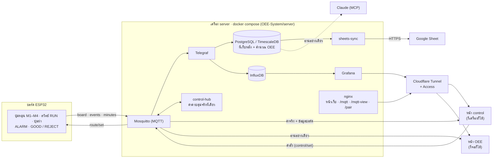

# Smart Factory OEE — Group 3

ระบบวัด OEE ของไลน์ผลิตจำลอง 4 เครื่อง บอร์ด ESP32 ส่งสัญญาณผ่าน MQTT ไปที่เครื่อง server ซึ่งเก็บข้อมูลลง database แสดงผลบนหน้าเว็บกับ Grafana และส่งสรุปขึ้น Google Sheet ถ้าไม่มีบอร์ด หน้า **control** จะเป็นบอร์ดจำลองแทน

| หน้า | ที่อยู่ (ผ่าน Cloudflare) | ในวง Wi-Fi | ทำอะไร |
|---|---|---|---|
| **OEE dashboard** | `https://oee.<domain>` | `http://<SERVER_IP>:8080` | แสดงผลอย่างเดียว ไม่ต้อง login |
| **Control** | `https://control.<domain>` | `http://<SERVER_IP>:8080/control.html` | ควบคุม / ดูสัญญาณบอร์ด ต้อง login ครั้งแรกครั้งเดียว |
| **Grafana** | `https://grafana.<domain>` | `http://<SERVER_IP>:3000` | กราฟสัญญาณสด |
| หน้าเว็บในบอร์ด | — | `http://192.168.1.200` | ใช้ได้แม้ server ปิด (ไม่บันทึกข้อมูล) |

รายละเอียดเชิงลึก (ตาราง database, สูตร OEE, topic MQTT) อยู่ใน [`OEE-System/README.md`](OEE-System/README.md)

---

## ภาพรวม



- **บอร์ด** อ่านปุ่ม / สวิตช์ ผลิตชิ้นงานเองตาม cycle แล้วส่ง 3 topic: `board` (สถานะสด ~1 ครั้ง/วินาที), `events` (กดปุ่ม / ผลิตเสร็จ), `minutes` (สรุปทุก 1 นาที)
- **Telegraf** เขียนทุกข้อความลง **PostgreSQL** (ที่เก็บหลัก) และ **InfluxDB** (ให้ Grafana)
- **control-hub** ถือค่าควบคุมจริงไว้ที่ server ที่เดียว หน้า control ทุกเครื่องเห็นค่าเดียวกัน หน้า OEE ทุกจอทำตาม และบันทึกการกดบนเว็บลง database เป็น `source = website`
- **sheets-sync** ส่งสรุป OEE และ Events ขึ้น Google Sheet
- **หน้า OEE** รับข้อมูลผ่าน MQTT ช่องอ่านอย่างเดียว (`/mqtt-view`) จึงไม่ต้องใส่รหัส และส่งคำสั่งไม่ได้

---

## มีอะไรใน repo

```
├── README.md                    ← ไฟล์นี้
├── OEE-System/
│   ├── README.md                ← รายละเอียดเชิงลึก
│   ├── server/                  ← docker compose ทั้งระบบ
│   │   ├── docker-compose.yml
│   │   ├── .env.example         ← แม่แบบรหัสผ่าน (copy เป็น .env)
│   │   ├── mosquitto/           ← config + สิทธิ์ (acl, acl_view)
│   │   ├── control-hub/         ← ค่าควบคุมจริง + รหัสจับคู่ 5 ตัว
│   │   ├── nginx/               ← เว็บ + ส่งต่อ /mqtt, /mqtt-view, /pair
│   │   ├── postgres/            ← ตาราง, view OEE
│   │   ├── telegraf/            ← MQTT → database
│   │   ├── sheets-sync/         ← database → Google Sheet
│   │   └── grafana/
│   ├── website/                 ← index.html (OEE), control.html, wiring-map.html
│   ├── esp32/                   ← โค้ดบอร์ด + build_web.py (ฝังหน้าเว็บลงบอร์ด)
│   └── google-sheets/           ← Apps Script (sheets_webapp.gs)
└── docs/machines/               ← ภาพเครื่องจักรต้นแบบ
```

> ⚠️ **รหัสผ่านไม่ได้อยู่ใน repo** หลัง clone ต้องสร้าง `OEE-System/server/.env` และ `OEE-System/esp32/SmartFactoryBoard_MQTT/secrets.h` เอง ทั้งสองไฟล์อยู่ใน `.gitignore` แล้ว ห้าม commit

---

## 1. ติดตั้งบนเครื่องใหม่

### 1.1 เครื่องมือ
| เครื่องมือ | ใช้ทำอะไร |
|---|---|
| **Git** | clone repo |
| **Docker** (Windows / Mac: Docker Desktop, Linux: Docker Engine + compose plugin) | รันทั้งระบบ |
| **Chrome หรือ Edge** | เปิดหน้าเว็บ |
| **Arduino IDE 2** + บอร์ด *esp32 by Espressif* (v3.x) + ไลบรารี *PubSubClient* | อัปโหลดโค้ดลงบอร์ด |

Windows: ตอนติดตั้ง Docker Desktop เลือกใช้ WSL 2 · Raspberry Pi: ใช้ Pi 4 / 5 กับ OS แบบ 64-bit

### 1.2 Clone และตั้งรหัสผ่าน
```bash
git clone https://github.com/tazriqq/Smart-Factory-G3.git
cd Smart-Factory-G3/OEE-System/server
cp .env.example .env          # Windows PowerShell: copy .env.example .env
```
เปิด `.env` แล้ว**เปลี่ยนทุกค่าที่ขึ้นต้นด้วย `change-me`** (สุ่มรหัสได้ด้วย `openssl rand -hex 16`):

| ค่า | ใส่อะไร |
|---|---|
| `INFLUX_ADMIN_PASSWORD`, `INFLUX_TOKEN` | รหัส InfluxDB (อย่างน้อย 8 ตัว) |
| `MQTT_ESP32_PASS` | รหัสของบอร์ด (ใช้อีกทีใน `secrets.h`) |
| `MQTT_WEB_PASS` **และ** `MQTT_PASS` | รหัสหน้า control — **สองช่องนี้ต้องเหมือนกัน** |
| `MQTT_HUB_PASS` | รหัสของ control-hub (สุ่มอะไรก็ได้) |
| `GRAFANA_ADMIN_PASSWORD` | รหัส Grafana |
| `PG_ADMIN_PASSWORD`, `PG_TELEGRAF_PASS`, `PG_READER_PASS` | รหัส database |
| `SHEETS_URL`, `SHEETS_KEY` | ยังไม่ใช้ Google Sheet ให้เว้น `SHEETS_URL=` ว่างไว้ |

> รหัส InfluxDB / PostgreSQL ใช้ตอนเปิดครั้งแรกเท่านั้น ถ้าเปิดไปแล้วค่อยแก้ ต้องล้างข้อมูลด้วย `docker compose down -v`

### 1.3 เปิดระบบ
```bash
docker compose up -d --build      # ครั้งแรกโหลด image ราว 1–2 GB
docker compose ps                 # ต้องขึ้นครบ 9 ตัว: mosquitto web timescaledb influxdb telegraf grafana sheets-sync control-hub backup
```

### 1.4 หา IP ของเครื่อง server
Windows `ipconfig` · Mac `ipconfig getifaddr en0` · Linux `hostname -I` แล้ว**ล็อก IP นี้ในเราเตอร์** (DHCP → Address Reservation) ไม่อย่างนั้นวันหนึ่ง IP เปลี่ยน แล้วบอร์ดหา server ไม่เจอ

---

## 2. บอร์ด ESP32

1. ในโฟลเดอร์ `OEE-System/esp32/SmartFactoryBoard_MQTT/` copy `secrets.example.h` เป็น `secrets.h` แล้วกรอก:
   ```cpp
   #define SECRET_WIFI_SSID   "ชื่อ Wi-Fi"        // 2.4 GHz วงเดียวกับ server
   #define SECRET_WIFI_PASS   "รหัส Wi-Fi"
   #define SECRET_MQTT_HOST   "<SERVER_IP>"
   #define SECRET_MQTT_PASS   "<MQTT_ESP32_PASS>"
   ```
   ถ้าวง Wi-Fi ไม่ใช่ `192.168.1.x` ให้แก้ `local_IP` / `gateway` ใน `.ino`
2. เปิด `SmartFactoryBoard_MQTT.ino` ใน Arduino IDE → Board **ESP32 Dev Module** · Partition Scheme **Huge APP (3MB No OTA/1MB SPIFFS)** → **Upload**
3. Serial Monitor (115200) ต้องเห็น `# Route: …`, `# Wi-Fi: connected, dashboard at http://192.168.1.200/` และ `# MQTT: connected`

- **หน้าเว็บในบอร์ด** (`http://192.168.1.200`) ฝังอยู่ใน `web_files.h` ถ้าแก้ `OEE-System/website/` ให้รัน `python3 esp32/build_web.py` (ในโฟลเดอร์ `OEE-System`) แล้วอัปโหลดบอร์ดใหม่
- **การต่อสาย:** [`OEE-System/website/wiring-map.html`](OEE-System/website/wiring-map.html) หรือในหน้า control (รูปบอร์ดที่บอกว่าแต่ละขาต่อกับอะไร กดแล้วเกิดอะไร + Wiring map)
- บอร์ดส่งข้อมูลพร้อมกันทุกช่องทาง: MQTT, Wi-Fi (`/data`), USB และ Bluetooth

---

## 3. หน้า OEE (dashboard)

- **แสดงผลอย่างเดียว ไม่ต้อง login** เปิดแล้วข้อมูลขึ้นเอง ป้ายมุมขวาบนบอกที่มาของข้อมูล:
  - `Live · via board` = ไลน์ทำตามบอร์ดจริง
  - `Live · control via website` = ไลน์ทำตามตัวจำลองของหน้า control
- แท็บ **Line** (ภาพ 3D ไลน์ผลิต) กับ **OEE Dashboard** (กราฟ / ตาราง OEE แต่ละเครื่อง) สลับได้ด้วยปุ่มบนหัวเว็บหรือกด `1` / `2`
- **แบบ minimal:** แถบไลน์ (กำลังผลิต · ผลผลิต · throughput · bottleneck) · ภาพ 3D กับป้ายเครื่อง (ความเร็ว · cycle · OEE) · แผงขวา (กะ / time frame 1 บรรทัด · timeline · เวลาเดิน / หยุด · A · P · Q · OEE · ดี / เสียแยกตาม product) · การตั้งค่าทั้งหมดอยู่หน้า control ส่วนรายละเอียดอยู่แท็บ OEE Dashboard
- **มือถือ:** ตรวจเองว่าเปิดจากมือถือ แล้วแสดงการ์ดข้อมูลสดแทนภาพ 3D ปุ่ม `📱 Simple view` / `🧊 3D view` บนหัวเว็บใช้สลับเองได้
- กล่อง **Products** บนภาพไลน์แสดงเส้นทางผลิต (แก้ได้ที่หน้า control)
- ต้องการช่องเชื่อมต่อแบบเดิม (Bluetooth / USB / Wi-Fi ตรงไปที่บอร์ด) ให้เปิด `…/?connect`

---

## 4. หน้า control

### 4.1 Login (ครั้งแรกในแต่ละเครื่อง)
- ใส่ user `web` และรหัส `MQTT_WEB_PASS` → **Log in** แล้วเบราว์เซอร์จะจำไว้
- **login เครื่องอื่นโดยไม่ต้องพิมพ์รหัส:** บนเครื่องที่ login แล้ว กด **📱 Share login (QR)** → server ออก**รหัสจับคู่ 5 ตัว** (เช่น `K7P2Q`) แสดงเป็น QR, ลิงก์ `…/#login=K7P2Q` และตัวรหัส → อีกเครื่องสแกน / เปิดลิงก์ / พิมพ์ในช่อง "รหัส 5 ตัว"
  - รหัส**ใช้ได้ครั้งเดียว ภายใน 10 นาที** · เดาผิด 10 ครั้งใน 10 นาทีถูกบล็อก 10 นาที (ล้างได้ด้วย `docker compose restart control-hub`)

### 4.2 บอร์ด หรือ ตัวจำลอง
| หน้า control | หน้า OEE |
|---|---|
| **VIA BOARD · BOARD CONNECTED** (เลือก *Connect board* และเจอบอร์ด) ดูสัญญาณจากบอร์ดอย่างเดียว | `Live · via board` |
| **SIMULATOR · CONTROL VIA WEBSITE** (กด *Disconnect board* หรือไม่เจอบอร์ด) หน้านี้เป็นบอร์ดจำลอง | `Live · control via website` (แม้บอร์ดจะยังเปิดอยู่) |
| **NOT LOGGED IN** | ไม่เปลี่ยน |

- ค่าเริ่มต้นคือ *Connect board*: บอร์ดหลุดจะใช้ตัวจำลองเอง และเมื่อบอร์ดกลับมาก็กลับไปใช้บอร์ด
- **ตัวจำลอง** มี: ปุ่มหมุนความเร็ว (0–200%), RUN / STOP, เปิด / ปิดฝา, Set / Maintenance, Alarm, Undo และไลน์จำลอง (Pause, 1× / 4× / 10×, Reset)
- **QC · ของดี / ของเสีย ต่อ product:** ทุกเส้นทางผลิต (A / B ที่มีเครื่อง) มีปุ่ม **✓ GOOD** / **✕ REJECT** ของตัวเอง พร้อม good · scrap · yield แยกกัน · บันทึกเป็น event `good` / `reject` พร้อม product · ปุ่ม 2 ปุ่มบน**บอร์ดจริง**ยังนับให้ product ที่มีชิ้นงานออกล่าสุด (โหมด MONITOR แสดงตัวนับแยกตาม product ของบอร์ด)

### 4.3 หลายเครื่องพร้อมกัน
- **ค่าจริงอยู่ที่ server ที่เดียว** (`control-hub`) เปิดหน้า control กี่เครื่องก็ได้ ทุกเครื่องเห็นค่าเดียวกันแบบ real time (เลื่อน slider บนโทรศัพท์ slider บน PC ก็ขยับตาม) และช่อง Events ขึ้น `… · from another device`
- **ถ้าชนกัน คนที่คำสั่งถึง server ก่อนชนะ** คำสั่งที่มาทีหลังถูก ignore และขึ้น `ignored: someone else changed … first`
- GOOD / REJECT / Undo / Reset นับทุกครั้ง

### 4.4 Shift & time frame (ของแผง OEE ทุกจอ)
- เวลาเริ่มกะ, ชั่วโมงทำงาน, เวลาพัก, ideal cycle, นาฬิกา (เวลาจริง / demo 1 วินาที = 1 นาที) และ time frame (15 นาที / 1 ชม. / 4 ชม. / ทั้งกะ / Custom) · ตั้งที่การ์ดนี้แล้วหน้า OEE ทุกจอเปลี่ยนตาม (เก็บที่ control-hub)
- **Clear OEE record** (กด 2 ครั้ง) ล้างบันทึกของแผง OEE ทุกจอ

### 4.5 ส่วนอื่นในหน้า
- **รูปบอร์ด ESP32:** ลากเส้นจากแต่ละขาไปบอกว่าต่อกับอะไร กดแล้วเกิดอะไร บันทึก event อะไร พร้อมสถานะสด (บนมือถือแสดงเป็นตาราง)
- **Wiring map**, **Events** (เวลาแบบ `2026-10-30 14:05:09:123`) และ **Raw lines**

---

## 5. เส้นทางผลิต 2 product

4 เครื่องแบ่งผลิตได้ 2 product (A / B) และเลือกได้ว่าแต่ละ product ผ่านเครื่องไหน ตามลำดับไหน: หน้า control → การ์ด **Products** → กดเครื่องตามลำดับ → **Apply**

| ตัวอย่าง | ความหมาย |
|---|---|
| `1234-` | product เดียว ผ่าน 01 → 02 → 03 → 04 |
| `12-34` | A: 01 → 02 · B: 03 → 04 |
| `13-24` | A: 01 → 03 · B: 02 → 04 (สายพานทแยงผ่านทางเดินกลาง) |
| `2-4` | A: 02 · B: 04 · 01 และ 03 ไม่ได้ใช้ (idle) |

- 1 เครื่องอยู่ได้ product เดียว · เครื่องแรกของแต่ละเส้นทางมีวัตถุดิบเอง · เครื่องสุดท้ายคือ output ของ product นั้น
- บอร์ดออนไลน์: เส้นทางถูกส่งไปที่บอร์ด (บอร์ดจำไว้แม้ปิดเครื่อง) · ตัวจำลอง: เส้นทางอยู่ใน control-hub
- เปลี่ยนเส้นทางแล้วชิ้นงานที่ค้างบนสายพานหายไป · GOOD / REJECT นับให้ product ที่มีชิ้นงานออกล่าสุด
- **รหัส + ชื่อสินค้า:** ในการ์ด Products ใส่ **รหัส** (เช่น `P-001`) และ **ชื่อสินค้า** (เช่น `Shaft S-100`) ของ A / B แล้วกด Enter หรือคลิกออก → หน้า OEE แสดงบนแถบไลน์ว่า *กำลังผลิต · line1 · A P-001 Shaft S-100 (01→02) · B …* และบนกล่อง Output · บันทึกเป็น event `product_info` · view `product_info` (ค่าล่าสุด) · `product_daily` และแท็บ **Products** ในชีตมีคอลัมน์ `code` / `name`
- database: OEE แต่ละเครื่องมีคอลัมน์ `product` · view `product_daily` · `product_info` · `route_history`

---

## 6. Google Sheet

```
database ──► sheets-sync (บน server) ──HTTPS + SHEETS_KEY──► Apps Script ──► Google Sheet (เขียนทับทั้งแท็บ)
```

| แท็บ | ข้อมูล | อัปเดต |
|---|---|---|
| **Events** | กดปุ่ม / สวิตช์ / ผลิตเสร็จ ล่าสุด · คอลัมน์ท้าย `source` = `board` หรือ `website` | ~10 วินาทีหลังมี event |
| **OEE_Daily** / **OEE_Hourly** | OEE แต่ละเครื่อง (และ product) รายวัน / รายชั่วโมง | ทุก 15 นาที |
| **Products** | output / good / reject / quality ของแต่ละ product รายวัน | ทุก 15 นาที |
| **Daily_Report** | สรุปประจำวันสำหรับผู้บริหาร (ดูด้านล่าง) | ทุก 15 นาที + ตอน `REPORT_AT` |
| **Machines** · **Notes** | ชื่อเครื่อง + `ideal_cycle_s` · คำอธิบายแต่ละแท็บ | ทุก 15 นาที |

- **เวลา** ทุกแท็บเป็น `YYYY-MM-DD hh:mm:ss:ms` (เวลาไทย)
- **ขนาดจำกัด:** ทุกแท็บไม่เกิน `SHEETS_MAX_ROWS` แถว (ค่าเริ่มต้น 1000) เก็บแถวใหม่สุด ของเก่าหลุดออก (first in, first out) ชีตจึงเล็กกว่า 1 MB ตลอด ส่วน database เก็บครบทุกแถว
- **source = website:** การกดบนหน้า control ก็ขึ้นชีตด้วย (RUN / ฝา / Set / Alarm / GOOD / REJECT / Undo / Reset / เส้นทาง / Connect-Disconnect board) แต่ **OEE / Quality / Products คิดจากบอร์ดอย่างเดียว**
- ชิ้นงานที่ตัวจำลองผลิตเสร็จไม่ขึ้นชีต เพราะเกิดในเบราว์เซอร์ ไม่ได้เกิดที่ server

### รายงานสรุปประจำวัน (ผู้บริหาร) → Google Sheet + LINE
- แท็บ **Daily_Report**: 1 แถวต่อวันต่อ line · `status` (final / today so far) · OEE ไลน์ + A · P · Q · output / good / reject · ชั่วโมงเดิน / หยุด · alarm (นาที, ครั้ง) · เครื่องดีสุด / ต่ำสุด · ผลผลิตแต่ละ product (รหัส, ชื่อ) · เทียบกับเมื่อวาน (คิดจากบอร์ดอย่างเดียว)
- **ทุกวันเวลา `REPORT_AT`** (ค่าเริ่มต้น 23:55 เวลาไทย) ส่งสรุปของวันนั้นไป **LINE** · server ปิดอยู่ตอนนั้นจะส่งย้อนหลังเมื่อเปิดกลับมา
- ดูข้อความก่อนส่ง: `docker compose exec sheets-sync python /sync.py report` (หรือ `report 2026-10-30`) · ส่งเดี๋ยวนี้: `… /sync.py report-send`

**ตั้งค่า LINE** (LINE Notify ปิดบริการแล้ว ต้องใช้ LINE Messaging API, ฟรี):
1. https://developers.line.biz/console → login ด้วย LINE → **Create a new provider** → **Create a Messaging API channel** (ระบบจะสร้าง LINE Official Account ให้)
2. ในแท็บ **Messaging API** → **Channel access token (long-lived)** → **Issue** → คัดลอกไปใส่ `LINE_CHANNEL_TOKEN=` ใน `server/.env`
3. สแกน QR ของบอทในแท็บเดียวกันด้วย LINE ในมือถือ → **เพิ่มเพื่อน** (ทุกคนที่จะรับรายงาน)
4. ส่งให้ใคร: เว้น `LINE_TO=` ว่าง = ส่งให้เพื่อนของบอททุกคน · หรือใส่ user ID ของตัวเอง (แท็บ **Basic settings** → *Your user ID*, ขึ้นต้นด้วย `U`) คั่นหลายคนด้วย `,`
5. `docker compose up -d sheets-sync` แล้วทดสอบ: `docker compose exec sheets-sync python /sync.py report-send`

**ตั้งค่า Google Sheet (ครั้งแรก):**
1. สร้าง Google Sheet → **Extensions → Apps Script** → วางทั้งไฟล์ `OEE-System/google-sheets/sheets_webapp.gs`
2. **Project Settings → Script properties** → `KEY` = ค่าเดียวกับ `SHEETS_KEY`
3. เลือกฟังก์ชัน **setup** → **Run** → อนุญาตสิทธิ์
4. **Deploy → New deployment → Web app** (Execute as **Me** · Who has access **Anyone**) → คัดลอก URL `/exec` ใส่ `SHEETS_URL`
5. `docker compose up -d sheets-sync` → `docker compose logs sheets-sync` ต้องเห็น `ok … rows`

**อัปเดต script** (เช่นหลัง `git pull`): วางไฟล์ใหม่ → **Deploy → Manage deployments → ✏️ → Version: New version → Deploy** (URL เดิม)

---

## 7. เข้าจากที่ไหนก็ได้ (Cloudflare)

ต้องมี domain บน Cloudflare และไม่ต้องเปิดพอร์ตที่เราเตอร์

**Tunnel:** Zero Trust → Networks → Tunnels → tunnel ของคุณ → **Routes** → **Add route** → **Published application**

| Subdomain | Service URL (cloudflared ติดตั้งบนเครื่อง) | (cloudflared ใน docker compose) |
|---|---|---|
| `oee` | `http://localhost:8080` | `http://web:80` |
| `control` | `http://localhost:8080` | `http://web:80` |
| `grafana` | `http://localhost:3000` | `http://grafana:3000` |

- ใช้ tunnel ที่มีอยู่แล้ว (เช่นของแอปอื่น) ได้เลย แค่ใช้ subdomain ไม่ซ้ำกัน · หรือใช้ cloudflared ใน compose: ใส่ `CLOUDFLARE_TUNNEL_TOKEN` ใน `.env` แล้ว `docker compose --profile tunnel up -d`
- oee กับ control ใช้พอร์ต 8080 ร่วมกัน โดย nginx เลือกหน้าตามชื่อ domain

**Cache:** Caching → Cache Rules → *Bypass cache* สำหรับ `oee.<domain>` และ `control.<domain>` (ไม่อย่างนั้นแก้หน้าเว็บแล้ว Cloudflare ยังส่งไฟล์เก่า)

**Cloudflare Access (แนะนำมาก):** Access → Applications → Add → Self-hosted → ใส่ `oee`, `control`, `grafana` → Policy *Allow · Emails* = อีเมลคนในทีม → login ด้วยรหัสทางอีเมล

---

## 8. ให้ Claude อ่าน database (MCP, ไม่บังคับ)

- **Claude Code บนเครื่อง server:** ในโฟลเดอร์ `OEE-System` copy `.mcp.example.json` เป็น `.mcp.json` ใส่ `PG_READER_PASS` → เปิด `claude` ในโฟลเดอร์นั้น → `/mcp`
- **Claude Desktop:** Settings → Developer → Edit Config → server `oee-db` ใช้ `uvx postgres-mcp --access-mode=restricted` กับ `DATABASE_URI=postgresql://reader:<PG_READER_PASS>@<SERVER_IP>:5432/factory`

---

## 9. ใช้งานประจำวัน (ในโฟลเดอร์ `OEE-System/server`)

```bash
docker compose ps                 # ดูสถานะ
docker compose logs -f telegraf   # ข้อมูลเข้า database ปกติไหม
docker compose restart            # รีสตาร์ททุกตัว
docker compose down               # หยุด (ข้อมูลยังอยู่) · down -v = ลบข้อมูลทั้งหมด
```

**อัปเดตโค้ดจาก GitHub** (ข้อมูลเดิมไม่หาย):
```bash
git pull
docker compose up -d --build --force-recreate
docker compose exec timescaledb sh /docker-entrypoint-initdb.d/init.sh   # อัปเดตตาราง / view
docker compose restart telegraf                                          # ให้ต่อ MQTT ใหม่แน่นอน
```
แล้วเช็กว่าข้อมูลบอร์ดเข้า database:
```bash
docker compose exec timescaledb psql -U factory_admin -d factory -c "SELECT max(time) FROM board"
```
ถ้า `esp32/` เปลี่ยน ให้อัปโหลดโค้ดบอร์ดใหม่ · ถ้า `google-sheets/` เปลี่ยน ให้อัปเดต Apps Script

**สำรองข้อมูลอัตโนมัติ:** service `backup` ทำ `server/backups/factory-YYYY-MM-DD.dump` ทุกวัน (ตอนเปิดและทุก 24 ชั่วโมง) เก็บย้อนหลัง `BACKUP_KEEP_DAYS` วัน (ค่าเริ่มต้น 14) · **คัดลอกโฟลเดอร์นี้และไฟล์ `.env` ไปเก็บนอกเครื่องเป็นระยะ** (ไม่อยู่ใน GitHub) · สำรองเองทันที: `docker compose exec -T timescaledb pg_dump -U factory_admin -Fc factory > factory.dump` · restore บนเครื่องใหม่: ดู [`OEE-System/README.md`](OEE-System/README.md)

**ตัวเฝ้าระวัง Telegraf:** `telegraf/watchdog.sh` รีสตาร์ต Telegraf เองเมื่อบอร์ดออนไลน์แต่ข้อมูลไม่เข้าเกิน `WATCHDOG_STALL_S` วินาที (ค่าเริ่มต้น 180) · ดู: `docker compose logs telegraf | grep watchdog`

**พอร์ตที่เปิดให้เครื่องอื่น:** 1883 (บอร์ด), 8080 (เว็บ), 3000 (Grafana), 5432 (PostgreSQL สำหรับ Claude Desktop จากเครื่องอื่น) · 9001 (MQTT WebSocket) และ InfluxDB เปิดเฉพาะบนเครื่อง server · หน้าเว็บต่อ MQTT ผ่าน nginx ที่ `/mqtt` / `/mqtt-view`

---

## 10. แก้ปัญหา

| อาการ | สาเหตุที่พบบ่อย | แก้ |
|---|---|---|
| ข้อมูลบอร์ดไม่เข้า database / ไม่ขึ้นชีต ทั้งที่บอร์ดออนไลน์ | Telegraf หลุดจาก MQTT (หลังสร้าง Mosquitto ใหม่) | watchdog แก้เองภายใน ~3–4 นาที · หรือ `docker compose restart telegraf` |
| หน้า control / OEE บนเครื่องอื่นต่อ MQTT ไม่ได้ | ยังจำที่อยู่เก่า `…:9001` (ปิดแล้ว) | เปิดหน้าใหม่ (ย้ายไป `/mqtt` ให้เอง) หรือแก้ช่อง broker เป็น `ws://<SERVER_IP>:8080/mqtt` |
| อยากได้ข้อมูลเมื่อวานคืน | — | `server/backups/factory-YYYY-MM-DD.dump` |
| หน้า OEE ไม่เปลี่ยนตามหน้า control | หน้า control เครื่องนั้นยังไม่ login / ยังเป็นหน้าเวอร์ชันเก่า | login หรือใช้ Share login · ปิดแท็บแล้วเปิดใหม่ |
| แก้หน้าเว็บแล้วผ่าน Cloudflare ยังเป็นของเก่า | Cloudflare cache | ตั้ง Cache Rule *Bypass cache* · กด Ctrl+Shift+R |
| `https://…` ขึ้น 502 / 1033 | tunnel / URL ผิด | Service URL ต้องเป็น `http://localhost:8080` (หรือ `http://web:80`) แบบ HTTP |
| Serial Monitor: `MQTT: failed (state -2)` | บอร์ดหา server ไม่เจอ | `SECRET_MQTT_HOST` ถูกไหม · server เปิดไหม · Wi-Fi เดียวกันไหม |
| Serial Monitor: `MQTT: failed (state 4)` | รหัสผิด | `SECRET_MQTT_PASS` ต้องเท่ากับ `MQTT_ESP32_PASS` |
| รหัส 5 ตัวขึ้น `too many wrong codes` | เดาผิดเกิน 10 ครั้ง | รอ 10 นาที หรือ `docker compose restart control-hub` |
| `sheets-sync` ขึ้น failed | ไม่มีเน็ต / Apps Script ตั้งไม่ครบ | Deploy เป็น Who has access: Anyone · ไม่ใช้ชีตให้เว้น `SHEETS_URL=` |
| `port is already allocated` | โปรแกรมอื่นใช้พอร์ต | แก้พอร์ตใน `.env` (`WEB_PORT`, `PG_PORT`, `INFLUX_PORT` …) |

---

## ความปลอดภัย (สรุป)

| ใคร / อะไร | ทำได้ |
|---|---|
| คนที่เปิดหน้า OEE (ไม่ต้องรหัส) | **ดู**ข้อมูลไลน์อย่างเดียว |
| คนที่ login หน้า control (`web`) | ส่งคำสั่งควบคุม / เปลี่ยนเส้นทาง / ขอรหัสจับคู่ · ปลอมข้อมูลบอร์ดหรือเขียน database ตรงๆ ไม่ได้ |
| บอร์ด (`esp32`) | ส่งข้อมูลจริง |
| control-hub (`hub`) | เขียนค่าควบคุมจริง + event `source = website` |

- ในวง Wi-Fi ใครเปิดหน้า OEE ก็เห็นข้อมูลไลน์ · จากข้างนอกควรกันด้วย **Cloudflare Access**
- รหัสจับคู่ / ลิงก์ Share login ให้เฉพาะคนในทีม

> หมายเหตุ: เครื่องจักรบนหน้าเว็บยังเป็น demo ไม่ใช่เครื่องจริง
